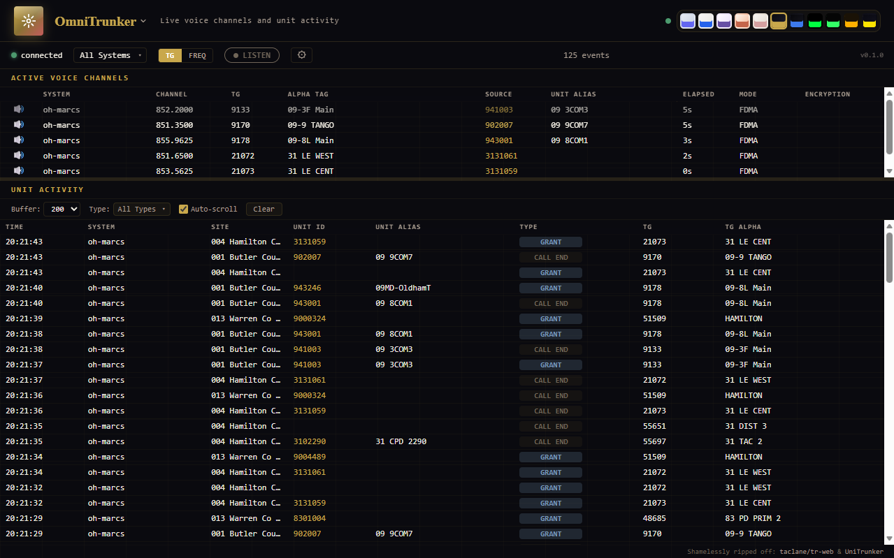

# OmniTrunker

A [Trunk Recorder Pro](https://trunkrecorder.pro) interface: live voice channels and unit activity,
dispatch-wall style, with per-talkgroup listening. It is a port of tr-engine's OmniTrunker page,
with the same look, layout, behaviour and themes, fed by the recorder's own API.

## What it shows

- **Active Voice Channels** (top): every call on the air now, with its system, site,
  frequency, talkgroup and alpha tag, the radio talking and its name, how long it has been going, the voice
  mode (FDMA, TDMA, analog, NXDN) and whether it is encrypted. Emergencies have a red edge.
  **TG** shows one row per talkgroup; **FREQ** one row per frequency, which stays (dimmed) when
  the call ends.
- **Site** column: the site the call is saved from, then a grey `+N` when the recorder also hears
  it on other sites (hover for their names).
- **L/R** column: where the talkgroup sits in the stereo field when you listen.
- **Unit Activity** (bottom): a feed of what happens, newest first. A **GRANT** row for each
  radio that talks on a call, a **CALL END** row when a call ends, and the recorder's notable
  events about radios and talkgroups: **NEW UNIT** and **NEW TG** (heard for the first time),
  **AFFILIATION** and **TONES** (a tone pattern).
- **Activity topic:** the page subscribes to the recorder's `activity` topic for affiliations; its
  per-talker and per-call kinds are left out, as the GRANT rows already show them. Filter it by type (the types seen so far) and by system; set how
  many rows it keeps.
- **LISTEN** plays the calls live in your browser, every call on the air at once.
- **Auto-pan** (the **Pan** checkbox beside the volume, and in the settings drawer; on by default)
  spreads the talkgroups across the stereo field, each always at its own spot, so overlapping
  calls can be told apart. The speaker icon on a row mutes
  that talkgroup; the settings drawer (the gear) has the whole talkgroup list to search, mute and
  unmute, the master volume, and which columns to show.
- The theme picker at the top right switches between the themes (Ctrl+Shift+T cycles them).

Settings are kept in the browser, per recorder.

## Serving it

On the recorder's **Interfaces** page, **Add a folder…** and pick this folder (or
`trunk-pro interface add <folder>`). For one run, `trunk-pro --ui <folder>`. It is served on a
port of its own, with the recorder's API beside it, and needs listen access only: it changes
nothing.

It loads nothing from the internet. The themes name their fonts (JetBrains Mono, Inter, …) and use
them when they are installed, else the computer's own.

Made for Trunk Recorder Pro 0.2.11 (interface API 1).

## License

MIT. The layout follows [taclane/tr-web](https://github.com/taclane/tr-web) and
[UniTrunker](https://www.unitrunker.com/).
